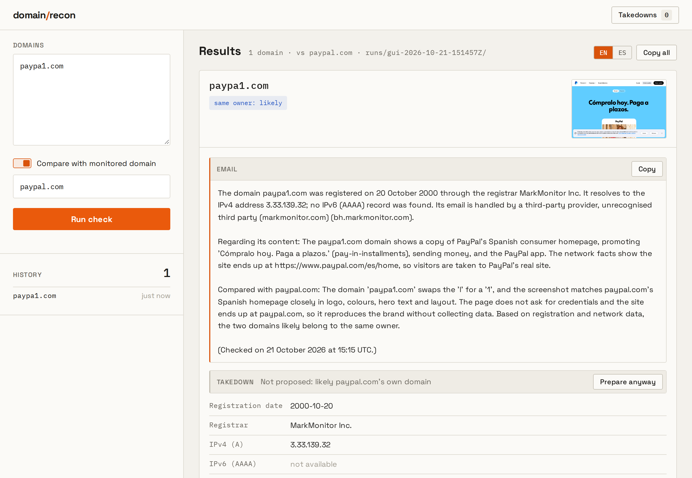

# domain-recon

Investigates suspicious domains (lookalikes, typosquats, phishing candidates) and compares each one
with the domain you protect.



*`paypa1.com` checked against `paypal.com`: the lookalike redirects to PayPal's real site, so the tool
judges that both likely have the same owner and proposes no takedown.*

For every domain it collects:

- **Registration**: creation date, registrar and statuses (RDAP, with whois as the fallback)
- **DNS**: A/AAAA, nameservers, reverse DNS, ASN and network owner; MX records and who runs the mail
- **The page**: screenshot, HTML, rendered DOM and CSS, captured in a headless browser
- **AI description** (optional, with your own key): what the page is and, against your domain, how
  the two compare and whether they seem to have the same owner. Works with Anthropic, OpenAI,
  Gemini, OpenRouter, xAI, Groq, Mistral or any OpenAI-compatible endpoint, such as a local Ollama
- **A short summary**, plus ready-to-paste email text in English and Spanish

Results print as plain text or JSON Lines, and the full evidence of every check stays in `runs/`.
A local web app shows results and history, and a takedown helper finds the abuse contacts and
prepares an evidence ZIP and draft reports. Nothing is ever sent.

## Install

Needs Python 3.12 or newer. Tested on Ubuntu 24.04; macOS should work the same way.
Clone this repository, then in its folder:

```bash
sudo apt install python3-venv whois                 # Ubuntu/Debian; macOS already has both
python3 -m venv .venv
.venv/bin/pip install -r requirements.txt
.venv/bin/playwright install --with-deps chromium   # the headless browser and its libraries
cp .env.example .env                                # settings, each one explained in the file
```

Add an `AI_API_KEY` to `.env` to turn on the AI description; everything else works without one.

Optional: ProjectDiscovery's [httpx](https://github.com/projectdiscovery/httpx)
(`go install github.com/projectdiscovery/httpx/cmd/httpx@latest`) adds the detected technologies,
favicon hash and CDN.

## Use

```bash
./recon suspicious-brand.com --target brand.com           # one domain against yours
./recon domains.txt --target brand.com -o results.jsonl   # a list: one JSON line per domain
./recon suspicious-brand.com                              # no target: just describe it
./recon suspicious-brand.com -t brand.com --email es      # also print the email text in Spanish
./recon web                                               # the web app, at http://127.0.0.1:8765
./recon takedown runs/<run>                               # prepare takedown cases for a run
./recon --help                                            # every command and option
```

A domain list has one domain per line; `#` starts a comment.

Before you start:

- Every check visits the site from your own IP address, and each run logs those visits in its
  `direct-contact.txt`. Use a VPN or a separate machine if the site must not see you.
- With an AI key set, the screenshot and a cleaned copy of the page go to that AI provider.

The web app bundles the Space Grotesk and IBM Plex Mono fonts under the SIL Open Font License
(see `domainrecon/web/static/fonts/`).
